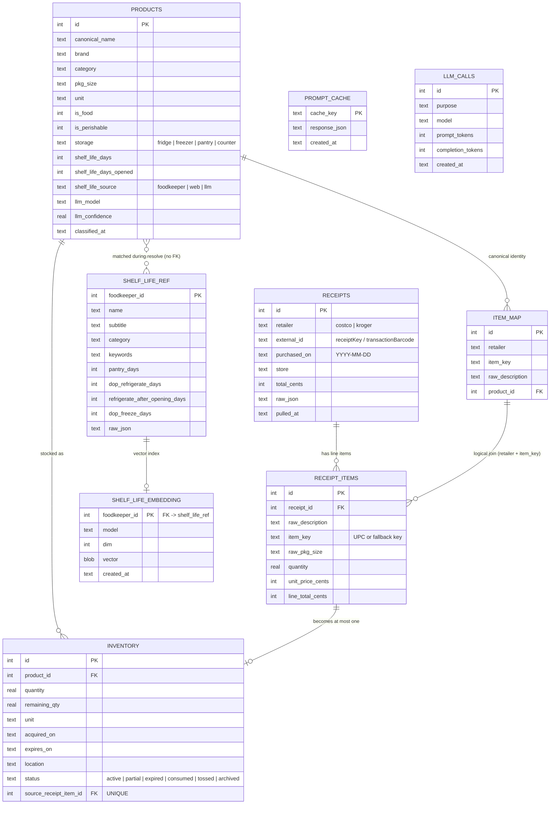
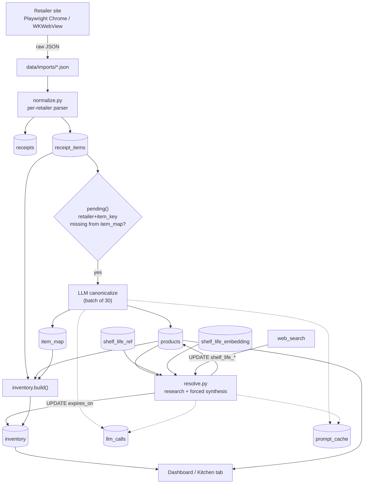

# Data model and flow

The Python schema in `food/db.py` is the source of truth. The iOS app carries an identical
schema in `mobile/ios/FoodCore/Sources/FoodCore/Schema.swift`, so both pipelines write the same
tables and run the same stages.

## ER diagram

## Data flow

## Stage by stage

| Stage | Reads | Writes | Key rule |
|---|---|---|---|
| Fetch | Retailer API via browser | `data/imports/*.json` | Raw archive; browser profile lives outside SQLite |
| Normalize | Raw JSON | `receipts`, `receipt_items` | `UNIQUE(retailer, external_id)` makes re-pulls idempotent |
| Canonicalize | `receipt_items` LEFT JOIN `item_map` | `products`, `item_map` | One product per `(retailer, item_key)`; unseen keys only |
| Resolve | `products`, `shelf_life_ref`, embeddings, web | `products.shelf_life_*`, `inventory.expires_on` | No FK to reference; values are copied, `shelf_life_source` records provenance |
| Inventory | `receipt_items` + `receipts` + `item_map` + `products` | `inventory` | One row per receipt line; `expires_on = purchased_on + shelf_life_days` only when perishable |
| Consumption | `inventory` | `inventory.remaining_qty/status` | FIFO oldest expiry first; active → partial → consumed/tossed; expired → archived after `ARCHIVE_AFTER_DAYS` |
| Read/UI | `inventory` JOIN `products`; details JOIN `receipt_items`→`receipts` | — | Dashboard never writes, only status actions do |

## The relationships that matter

- `receipts` → `receipt_items`: 1-to-many, `ON DELETE CASCADE`.
- `item_map`: the bridge table. Its unique `(retailer, item_key)` is what lets `receipt_items`
  join to `products`; that join is **logical, not a declared FK**.
- `products` → `inventory`: 1-to-many. Repeat purchases create separate inventory rows, not
  quantity updates.
- `receipt_items` → `inventory`: 1-to-0..1, enforced by `UNIQUE(source_receipt_item_id)`.
- `shelf_life_ref` → `shelf_life_embedding`: 1-to-0..1, cascade delete.
- `products` ↔ `shelf_life_ref`: *no stored relationship*. The resolver uses the reference at
  runtime and copies the answer into `products`; `foodkeeper_id` was deliberately dropped from
  `products`.
- `prompt_cache` (cache key → JSON) and `llm_calls` (audit/budget log) are standalone side
  tables, not part of the kitchen graph.
- `schema_version` is a single-row migration marker (currently 2).

## Mental model

`receipts` is **what you bought**, `products` is **what it is**, `item_map` is **how retailer
SKUs resolve to products**, and `inventory` is **what is still in your kitchen**. The only
mutable state after ingestion is `inventory.remaining_qty/status` and the shelf-life columns on
`products`; everything else is append/upsert.

The iOS app runs the exact same schema and the same stages in `Sync.run` (fetch in `WebModel` →
`Store` → `Canonicalize` → `ShelfLifeAgent` → `Inventory`), just against the on-device SQLite
file.
